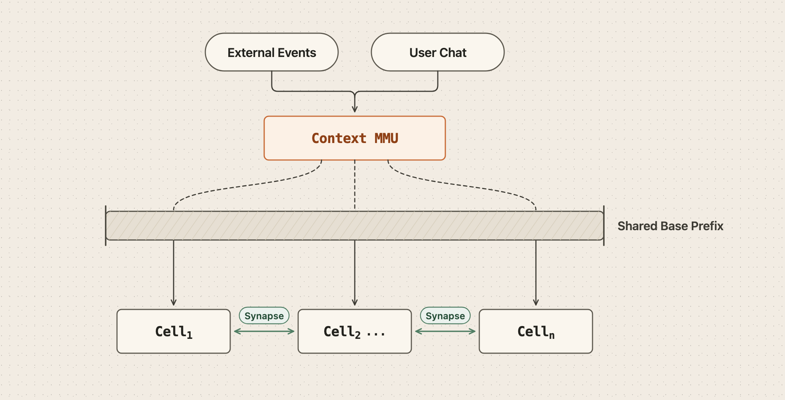

# ClonAct

**Scheduling context blocks as resources for always-on personal agents.**

[](https://viacol.pages.dev/blog/context-as-a-resource/)
[](https://arxiv.org/abs/2611.26346)
[](LICENSE)

[中文](README_zh.md) · [Reproduction](docs/reproducibility.md)

ClonAct coordinates agents handling interleaved conversations, external events, and concurrent tasks. Persistent **Context Cells** retain each task's working context and exchange relevant updates. A Python control plane schedules the Cells; every Worker executes through **DeepSeek DSH Agent**.



The **Context MMU** routes messages and manages Cell lifecycles. The **Shared Trunk** maintains a shared context prefix of common rules and cross-task knowledge; the **Synaptic Bus** carries targeted updates between Cells. Coding tasks use isolated Git worktrees. See the [blog](https://viacol.pages.dev/blog/context-as-a-resource/) for the design and evaluation.

## Installation

Use **Python 3.11**, **Node.js 24+**, and **pnpm 11.7.0**. Live benchmark isolation currently requires **macOS with `sandbox-exec`**. PostgreSQL tracks need Docker; DSH telemetry needs `zstd`.

From the repository root:

```sh
python3.11 -m venv .venv
.venv/bin/python -m pip install -e '.[dev,data]'
pnpm --dir dsh_runner install --frozen-lockfile

# Verify the installed entry points; these commands do not call a model.
.venv/bin/python -m synaptic_bench_150.runner --version
.venv/bin/python -m appworld_micro_30.runner --version
.venv/bin/python -m synaptic_stream_60.runner --version
```

Follow the [reproduction guide](docs/reproducibility.md) to install the comparison baseline, provision ARE/AppWorld, reconstruct the datasets, and configure credentials. The required DSH Worker bridge is included in `dsh_runner/`.

## Benchmarks

| Benchmark | Evaluation scope |
| --- | --- |
| **Synaptic-Bench-150** (`Bench-150`, stratified subset `Bench-60`) | 150 office, coding, and hybrid episodes with interleaved tasks (`413` deterministic verifiers) |
| **AppWorld-Micro-30** (`Micro-30`) | 30 episodes composing 60 app-disjoint AppWorld tasks across three tracks (`100` verifiers) |
| **Synaptic-Stream-60** (`Stream-60`) | 3 conflict-free 240-event continuous streams (60 tasks) under Moderate and 2.5× Surge arrival rates |

Task contents are downloaded and composed locally from pinned source manifests. Integrity checks verify the generated episodes and streams against the frozen datasets. All three benchmarks start at public release **1.0.0**; [version provenance](docs/benchmark-versions.md) records the corresponding internal research revisions.

The primary experiments used **DeepSeek V4.1-Flash-1017**. The commands below retain the `deepseek-flash` API model identifier used by the implementation; this identifier alone does not pin the provider to the historical model snapshot.

After completing setup, run:

```sh
# These commands invoke model APIs.
.venv/bin/python -m synaptic_bench_150.runner \
  --arms clonact,dsh_superagent --model deepseek-flash \
  --output-dir experiments/outputs/synaptic/new-run

.venv/bin/python -m appworld_micro_30.runner \
  --arms clonact,dsh_superagent --model deepseek-flash \
  --output-dir experiments/outputs/appworld/new-run

.venv/bin/python -m synaptic_stream_60.runner \
  --arms clonact,dsh_superagent --regimes moderate,surge --model deepseek-flash \
  --output-dir experiments/outputs/stream60/new-run
```

Use a separate output directory for each model and configuration. Additional orchestration baselines and ClonAct ablations are documented in the [runtime guide](docs/runtime.md).

## Repository structure

```text
clonact/                Context MMU, Cells, shared Trunk, and Synaptic Bus
dsh_runner/             DSH hosts, sandbox integration, and Worker bridge
synaptic_bench_150/     Dataset builder, runner, and evaluators
appworld_micro_30/      Composition recipes, runner, and evaluators
synaptic_stream_60/     Conflict-free continuous stream builder, watcher, and runner
tests/                  Regression checks
scripts/                Local validation tools
docs/                   Setup, architecture, and reproduction guides
```

## Contributing and citation

See [CONTRIBUTING.md](CONTRIBUTING.md) for development and testing. To cite ClonAct, use [CITATION.cff](CITATION.cff) and acknowledge the upstream benchmarks used in your experiments.

## License

Original ClonAct code and composition recipes are licensed under [MIT](LICENSE). Third-party software and benchmark data retain their own terms; see [THIRD_PARTY_NOTICES.md](THIRD_PARTY_NOTICES.md). Generated task data and raw execution traces are not public release assets.
