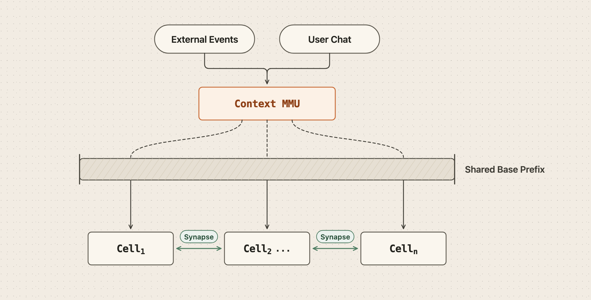

# ClonAct

**把上下文块作为资源调度，支持持续运行的个人智能体。**

[](https://viacol.pages.dev/blog/context-as-a-resource/)
[](https://arxiv.org/abs/2611.26346)
[](LICENSE)

[English](README.md) · [复现指南](docs/reproducibility.md)

ClonAct 面向对话、外部事件和多个任务交错到来的场景。持续存在的 **Context Cell（上下文单元）**保留每个任务的工作上下文，并交换相关更新。Python 控制面负责调度，所有 Worker 均通过 **DeepSeek DSH Agent** 执行。



**Context MMU** 路由消息并管理 Cell 生命周期；**Shared Trunk（共享上下文前缀）**维护公共规则与跨任务知识；**Synaptic Bus** 在 Cell 之间传递有针对性的更新。代码任务使用隔离的 Git worktree。设计与评测详见[博客](https://viacol.pages.dev/blog/context-as-a-resource/)。

## 安装

使用 **Python 3.11**、**Node.js 24+** 和 **pnpm 11.7.0**。当前运行隔离需要支持 **`sandbox-exec` 的 macOS**；PostgreSQL 任务需要 Docker，DSH 遥测需要 `zstd`。

在仓库根目录执行：

```sh
python3.11 -m venv .venv
.venv/bin/python -m pip install -e '.[dev,data]'
pnpm --dir dsh_runner install --frozen-lockfile

# 检查安装后的入口；这些命令不调用模型。
.venv/bin/python -m synaptic_bench_150.runner --version
.venv/bin/python -m appworld_micro_30.runner --version
.venv/bin/python -m synaptic_stream_60.runner --version
```

按[复现指南](docs/reproducibility.md)安装对比基线、准备 ARE/AppWorld 环境、重建题集并配置凭据。必需的 DSH Worker 桥接插件已包含在 `dsh_runner/` 中。

## 评测集

| 评测集 | 评测内容 |
| --- | --- |
| **Synaptic-Bench-150**（简称 `Bench-150`，分层子集 `Bench-60`） | 150 道办公、代码与混合场景题，包含交错到来的任务（`413` 项确定性校验） |
| **AppWorld-Micro-30**（简称 `Micro-30`） | 60 个无耦合 AppWorld 任务组成 30 道题，覆盖三类轨道（`100` 项校验） |
| **Synaptic-Stream-60**（简称 `Stream-60`） | 3 条无文件冲突的 240 事件连续流（共 60 题），覆盖 Moderate 与 2.5× Surge 双到达负载 |

任务内容由用户根据固定来源清单在本地下载和组合，生成的题集须通过冻结数据的完整性校验。三套评测集的首个公开版本均为 **1.0.0**，对应的内部研究版本记录在[版本溯源说明](docs/benchmark-versions.md)中。

主要实验使用 **DeepSeek V4.1-Flash-1017**。以下命令沿用实现中的 API 模型标识 `deepseek-flash`；仅凭这一标识不能将服务端固定到当时的模型快照。

完成环境与数据准备后，运行：

```sh
# 以下命令会调用模型 API。
.venv/bin/python -m synaptic_bench_150.runner \
  --arms clonact,dsh_superagent --model deepseek-flash \
  --output-dir experiments/outputs/synaptic/new-run

.venv/bin/python -m appworld_micro_30.runner \
  --arms clonact,dsh_superagent --model deepseek-flash \
  --output-dir experiments/outputs/appworld/new-run

.venv/bin/python -m synaptic_stream_60.runner \
  --arms clonact,dsh_superagent --regimes moderate,surge --model deepseek-flash \
  --output-dir experiments/outputs/stream60/new-run
```

每个模型与配置使用独立的输出目录。其他编排基线和 ClonAct 消融配置见[运行指南](docs/runtime.md)。

## 代码结构

```text
clonact/                Context MMU、Cell、Shared Trunk 与 Synaptic Bus
dsh_runner/             DSH Host、沙箱集成与 Worker 桥接插件
synaptic_bench_150/     题集构建器、runner 与评测器
appworld_micro_30/      组合配方、runner 与评测器
synaptic_stream_60/     无冲突连续流题集构建器、watcher 与 runner
tests/                  回归测试
scripts/                本地验证工具
docs/                   安装、架构与复现说明
```

## 贡献与引用

开发与测试要求见 [CONTRIBUTING.md](CONTRIBUTING.md)。使用 ClonAct 时，可通过 [CITATION.cff](CITATION.cff) 引用，并注明实验中使用的上游评测集。

## 许可证

ClonAct 原创代码与组合配方采用 [MIT](LICENSE)。第三方软件和评测数据保留各自的条款，详见 [THIRD_PARTY_NOTICES.md](THIRD_PARTY_NOTICES.md)。生成的题集与原始运行轨迹不作为公开发布内容。
